<div align="center">

# 結束 · Kessoku Desktop

### Anime Music Edition

Un escenario para tu escritorio. Debian estable, Plasma nativo y mucho rock japonés.


[Galería](#nueve-personajes-nueve-ambientes) · [Empezar](#probalo-en-plasma) · [Terminal](#una-terminal-a-la-altura) · [Recuperación](#volver-atrás)

</div>

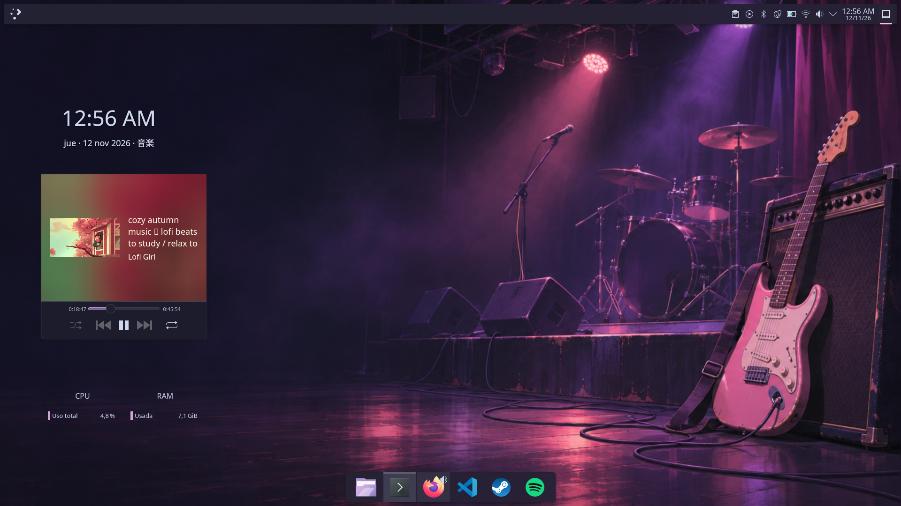

Un rice personal inspirado en **Bocchi the Rock!** y **K-On!**: luces de escenario, superficies oscuras, vidrio y acentos suaves. Los widgets viven en el escritorio; la barra superior se mantiene limpia. Todo gira alrededor de componentes nativos de Plasma y efectos incluidos en KWin.

## Lo que hace especial al escritorio

| Superficie | Diseño |
| :--- | :--- |
| **Panel superior** | Flotante y translúcido, con lanzador, escritorios, bandeja y reloj. |
| **Dock** | Centrado, iconos grandes e indicadores; se oculta cuando una ventana lo necesita. |
| **Escritorio** | Reloj protagonista, tarjeta MPRIS con carátula y controles, CPU y RAM discretas. |
| **Ventanas** | Blur, Scale, Magic Lamp y movimiento suave. Factor de animación ajustado a **0,75**. |
| **Color** | Base Comfort oscura: selección legible y filas alternadas sutiles en Dolphin. |
| **Terminales** | Konsole y Kitty, colores coordinados, Nerd Font y un extra opcional de Zsh + Starship. |
| **Identidad** | Nueve variantes con ilustración propia, originales y wallpapers **QHD / 4K**. |

## Nueve personajes, nueve ambientes

Cada miniatura abre el fondo 4K. Las variantes cambian colores y wallpaper, conservando paneles, widgets y animaciones.

<table>
<tr>
<td align="center" width="33%"><a href="themes/bocchi/wallpaper-4k.png">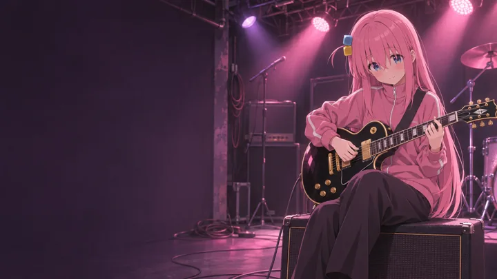</a><br><b>Bocchi</b> · Rosa<br><code>bocchi</code></td>
<td align="center" width="33%"><a href="themes/nijika/wallpaper-4k.png">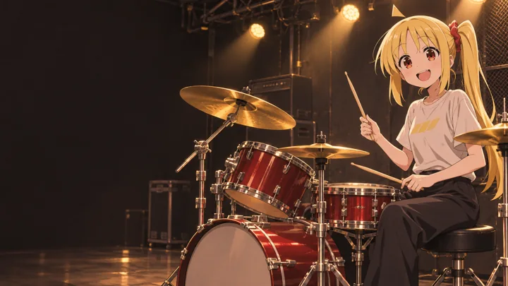</a><br><b>Nijika</b> · Amarillo<br><code>nijika</code></td>
<td align="center" width="33%"><a href="themes/ryo/wallpaper-4k.png">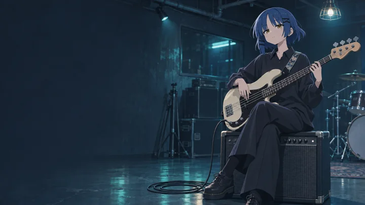</a><br><b>Ryo</b> · Azul frío<br><code>ryo</code></td>
</tr><tr>
<td align="center"><a href="themes/kita/wallpaper-4k.png">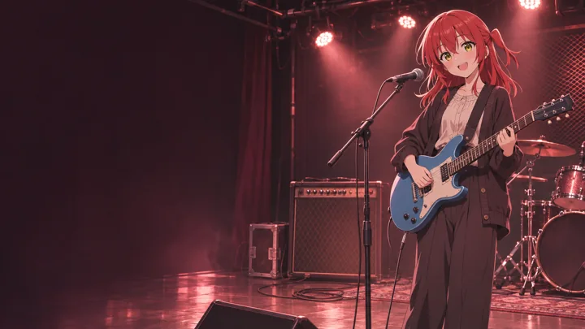</a><br><b>Kita</b> · Coral rojo<br><code>kita</code></td>
<td align="center"><a href="themes/kikuri/wallpaper-4k.png">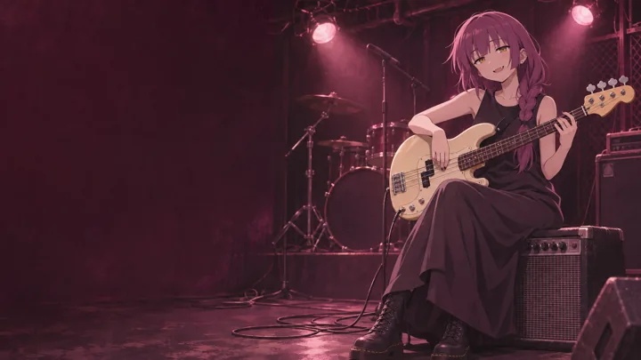</a><br><b>Kikuri</b> · Ciruela<br><code>kikuri</code></td>
<td align="center"><a href="themes/yui/wallpaper-4k.png">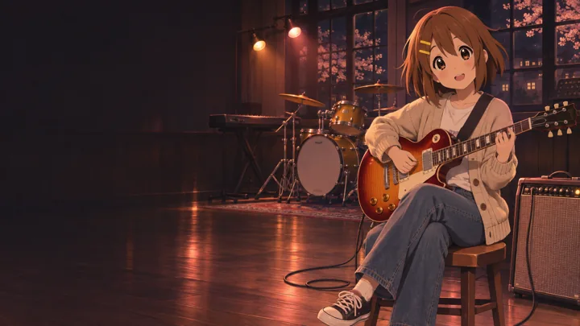</a><br><b>Yui</b> · Coral cálido<br><code>yui</code></td>
</tr><tr>
<td align="center"><a href="themes/mio/wallpaper-4k.png">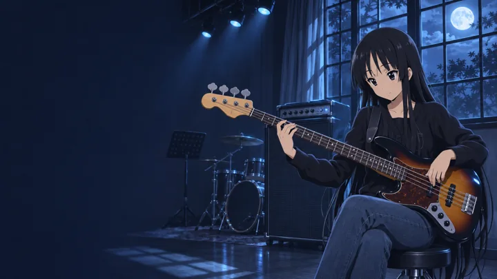</a><br><b>Mio</b> · Azul nocturno<br><code>mio</code></td>
<td align="center"><a href="themes/ritsu/wallpaper-4k.png">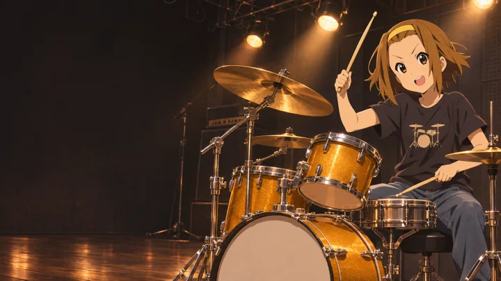</a><br><b>Ritsu</b> · Ámbar<br><code>ritsu</code></td>
<td align="center"><a href="themes/tsumugi/wallpaper-4k.png">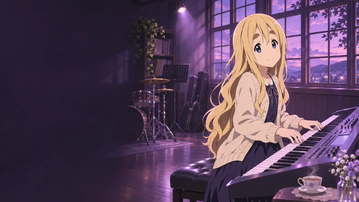</a><br><b>Tsumugi</b> · Lavanda<br><code>tsumugi</code></td>
</tr>
</table>

También está **`base`**, el escenario original sin personaje de la captura principal.

Las ilustraciones fueron generadas con imagegen y reescaladas mediante Upscayl High Fidelity; **4K es la resolución de entrega, no la generación original**. Son interpretaciones de fan art, no arte oficial. [Prompts de Kessoku Band](themes/bocchi-prompts.json) · [Especificaciones de HTT y Kikuri](themes/prompts.json).

## Probalo en Plasma

Probado en **Debian 13.7 · Plasma/KWin 6.3.6 · Wayland · 1920 × 1080, escala 100 %**. El selector necesita Python 3 y las herramientas KDE `qdbus6`, `kreadconfig6`, `plasma-apply-colorscheme` y `plasma-apply-wallpaperimage`; `kdialog` para su menú gráfico. Debe ejecutarse como tu usuario dentro de una sesión Plasma.

```bash
git clone https://github.com/Cundalf/kessoku-desktop.git
cd kessoku-desktop

# Ver personajes disponibles y aplicar colores + wallpaper
scripts/theme.sh --list
scripts/theme.sh bocchi

# Selector gráfico y acceso opcional en el menú
scripts/theme.sh
scripts/install-theme-launcher.sh

# Copiar la colección a ~/Pictures/Wallpapers/{HTT,Kessoku}
scripts/install-character-wallpapers.py
```

El selector guarda un respaldo antes de cada cambio. No modifica la distribución de tus paneles ni instala widgets. Conservá el directorio del proyecto: el wallpaper aplicado apunta a sus archivos.

> **Alcance del rice completo:** este repositorio documenta un escritorio personal, no es un instalador universal. `apply.sh`, `rollback.sh`, `validate.sh` y las pruebas de recuperación completa dependen de los respaldos privados del equipo original; el panel superior usa su ID local. Esos respaldos no se publican. `install.sh` necesita además el paquete de fuentes descargado localmente. Para otro equipo, usá el selector y los extras independientes, y adaptá la disposición revisando [el diseño](docs/DESIGN.md) y [los componentes](docs/COMPONENTS.md).

## Una terminal a la altura

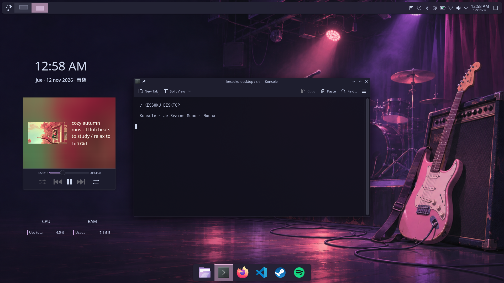

**Konsole** conserva su perfil oscuro con JetBrains Mono y blur. **Kitty** convive con ella y usa tu shell habitual. Su instalador descarga una versión fijada y comprueba hash y firma antes de instalarla en el usuario.

```bash
python3 extras/terminal/install-kitty.py
```

El extra de Zsh + Starship es independiente y opcional: incluye los plugins fijados y FiraCode Nerd Font. Necesita las herramientas indicadas en su documentación y mantiene tus dotfiles personales.

```bash
python3 extras/terminal/install.py
extras/terminal/launch.sh kitty
```

[Configuración, dependencias y desinstalación →](extras/terminal/README.md)

## Volver atrás

Cada cambio de tema imprime la ruta de su respaldo. Para restaurar sus colores y fondos:

```bash
scripts/theme-restore.sh backups/before-theme-FECHA-IDENTIFICADOR
```

La restauración de temas usa las APIs de Plasma. La recuperación **completa** del escritorio original es un procedimiento distinto y local, ensayado con plasmashell detenido: [guía de TTY y rollback](docs/ROLLBACK.md).

## Dentro del proyecto

```text
assets/       Capturas, previews y escenario original
configs/      Plasma, KWin, colores, Konsole y Fastfetch
themes/       Catálogo, paletas y wallpapers por personaje
extras/       Kitty y entorno de terminal opcional
scripts/      Aplicación, selector, validación y recuperación
docs/         Diseño, compatibilidad y decisiones técnicas
tests/        Pruebas aisladas del flujo local
```

Los respaldos personales, descargas, binarios y archivos intermedios de IA permanecen fuera de Git. Los originales y fondos finales sí están incluidos. `themes/SHA256SUMS` comprueba la integridad de los recursos publicados.

<details>
<summary><b>Notas técnicas y créditos</b></summary>

- [Diseño y paleta](docs/DESIGN.md) · [Temas y recuperación](docs/CHARACTER-THEMES.md)
- [Componentes evaluados](docs/COMPONENTS.md) · [Informe de la implementación](docs/FINAL.md)
- [Reescalado con Upscayl](docs/UPSCALING.md) · [Historial](docs/CHANGELOG.md)
- Las nueve variantes se aplicaron y validaron en la sesión original; también se probó volver al tema anterior. Las capturas muestran el escritorio base y una prueba de terminal.
- KDE Plasma y KWin proporcionan paneles, widgets y efectos; no se reemplaza el compositor ni se instalan parches de KWin.
- Los plugins de Zsh y la fuente vendorizados conservan sus licencias y autores. Las revisiones están en [plugins.lock.json](extras/terminal/plugins.lock.json).
- Referencias visuales: Bocchi the Rock!, K-On!, Catppuccin y la comunidad de r/unixporn. Los personajes pertenecen a sus respectivos titulares; el proyecto no está afiliado a esas obras.

</details>

<div align="center">

**放課後、もう一曲。**<br>
<sub>Una canción más, después de clase.</sub>

</div>
